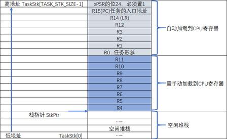
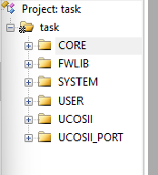
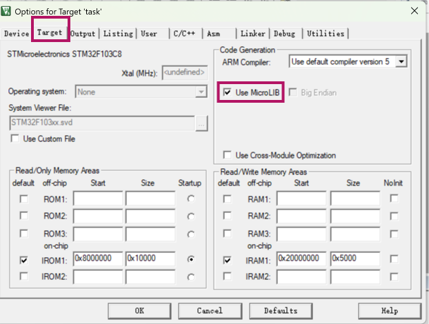
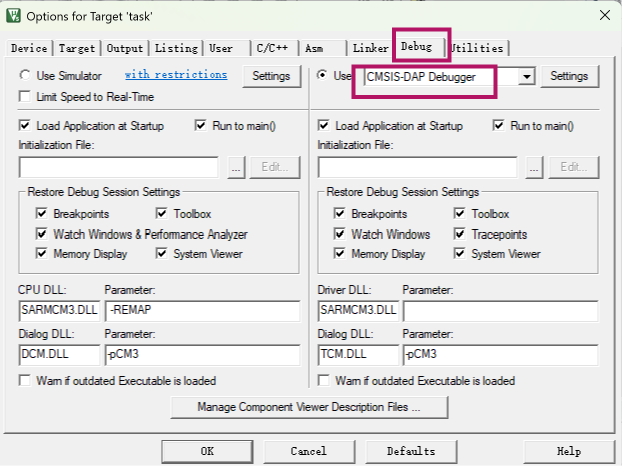
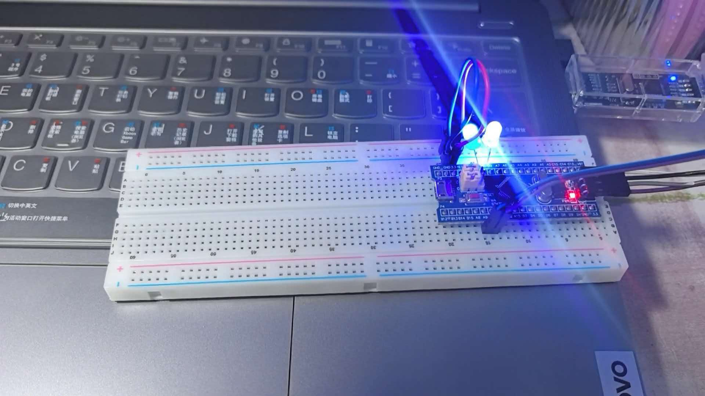
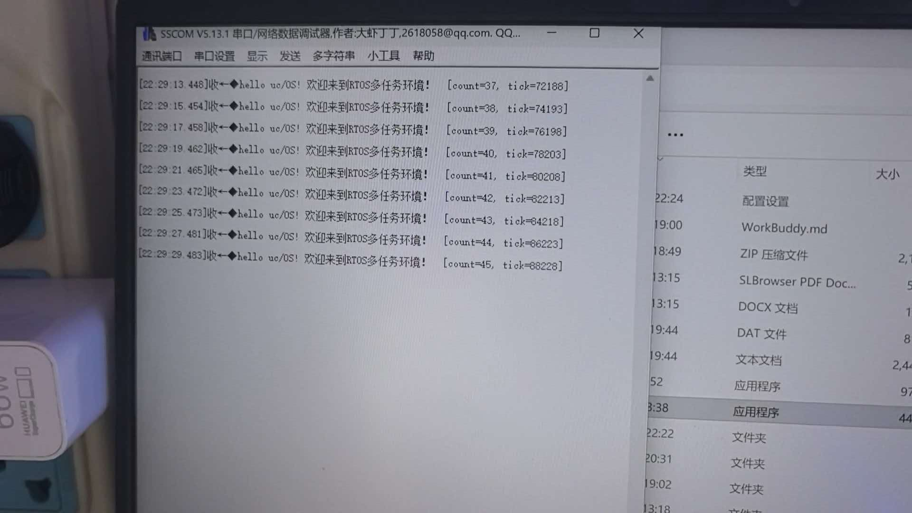
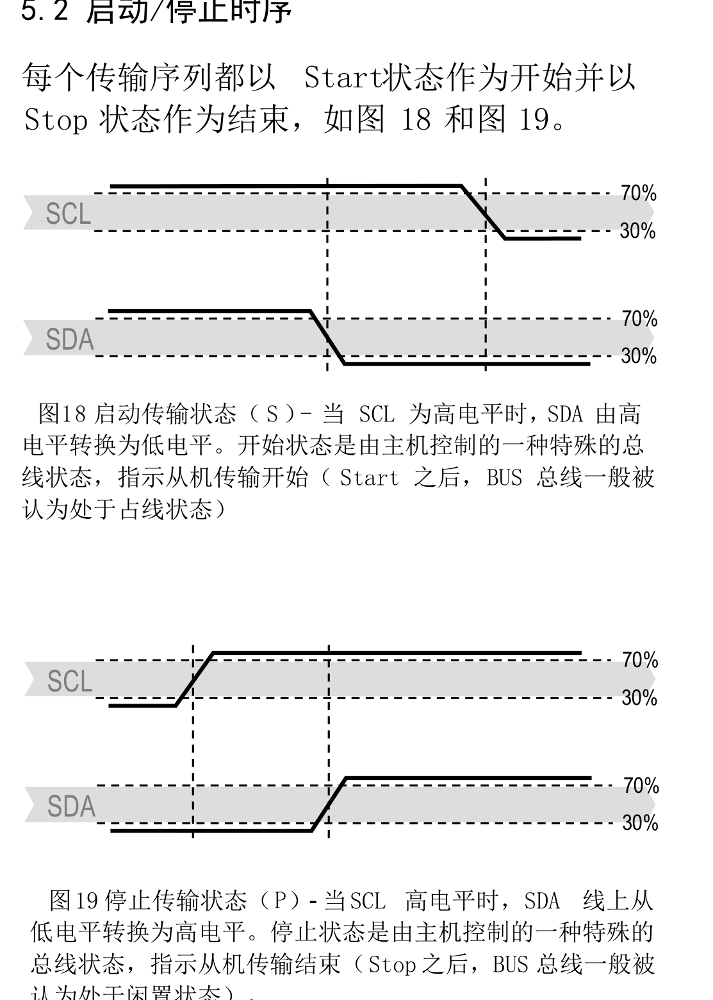
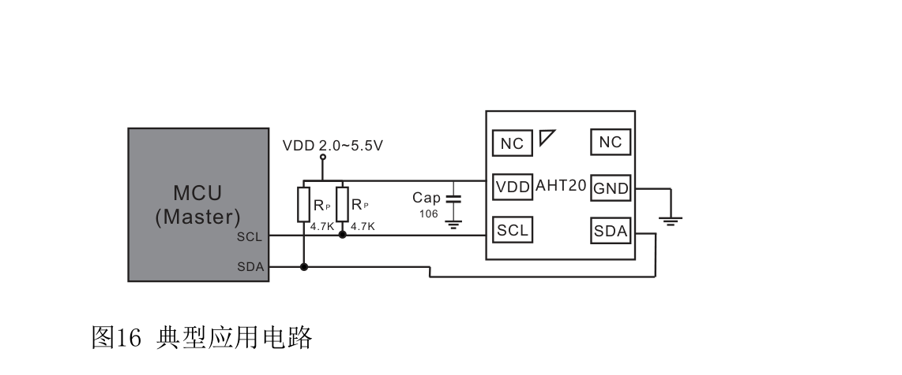
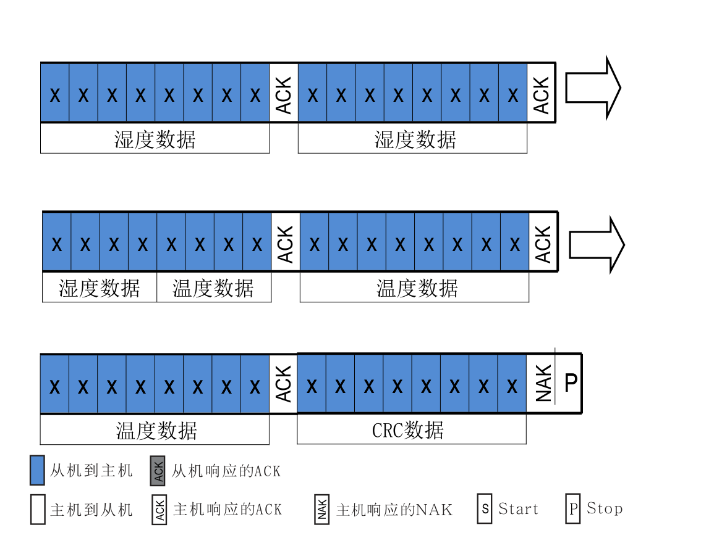

# STM32F103 uC/OS-II 移植与 AHT20 温湿度采集

[TOC]

# 一、任务一：uC/OS-II 移植

## 1.1 为什么要用 RTOS

裸机程序通常是 `while(1)` 里顺序执行，需要等待就调 `delay_ms()`。等待期间 CPU 空转，而且动作只能排队：两个 LED 要 1 s、3 s 翻转，串口要 2 s 发一次，把延时写在一个循环里，前面的耗时会累加到后面，三个周期都会偏。

RTOS 把每个周期性动作拆成独立任务，任务里用 `OSTimeDly()` 等待。等待时任务被挂起，CPU 交给其他任务，每个任务的延时由内核节拍单独计数。

uC/OS-II 是抢占式内核，就绪任务里优先级最高的先运行，数值越小优先级越高。本工程 `OS_LOWEST_PRIO = 31`，31 留给空闲任务，用户任务用 0~30。

## 1.2 需要移植哪些文件

uC/OS-II 的源码里只有贴近 CPU 的一层和芯片有关，其余调度、信号量、消息队列都是纯 C，不用改：

| 文件 | 作用 |
| --- | --- |
| `os_cpu.h` | 数据类型、栈增长方向、临界区宏 |
| `os_cpu_c.c` | `OSTaskStkInit()`、`OS_CPU_SysTickInit()`、钩子函数 |
| `os_cpu_a.asm` | `OSStartHighRdy`、`OSCtxSw`、`OSIntCtxSw`、`PendSV_Handler` |
| `os_cfg.h` | 裁剪功能、设定节拍频率 |

## 1.3 三个关键点

### ① 临界区（`os_cpu.h`）

Cortex-M3 有专用的 `CPSID I` / `CPSIE I` 指令，只改 PRIMASK 一位，比读改写整个寄存器安全，所以用方法 3：

```c
#define  OS_CRITICAL_METHOD   3

#if OS_CRITICAL_METHOD == 3
#define  OS_ENTER_CRITICAL()  { cpu_sr = OS_CPU_SR_Save(); }
#define  OS_EXIT_CRITICAL()   { OS_CPU_SR_Restore(cpu_sr); }
#endif
```

`OS_CPU_SR_Save/Restore` 用汇编实现（`MRS`/`MSR` 操作 PRIMASK），保证"保存 + 关中断"一步完成。栈方向也要定义成递减：

```c
#define  OS_STK_GROWTH        1
```

### ② 任务初始栈（`os_cpu_c.c`）

Cortex-M3 进中断时硬件自动压 8 个寄存器，R0-R3、R12、LR、PC、xPSR。uC/OS-II 切换任务靠手动恢复现场，所以创建任务时要先在栈里造一个"刚被中断打断"的现场，第一次调度到该任务时，`PendSV` 里出栈的动作一执行，CPU 就跳到了任务函数开头。

```c
OS_STK *OSTaskStkInit(void (*task)(void *pd), void *p_arg, OS_STK *ptos, INT16U opt)
{
    OS_STK *stk = ptos;

    *(stk)   = (INT32U)0x01000000L;              /* xPSR，T 位必须为 1 */
    *(--stk) = (INT32U)task;                     /* PC：任务入口 */
    *(--stk) = (INT32U)0xFFFFFFFEL;              /* LR：非法值，return 立刻出错 */
    *(--stk) = (INT32U)0x12121212L;              /* R12 */
    *(--stk) = (INT32U)0x03030303L;              /* R3  */
    *(--stk) = (INT32U)0x02020202L;              /* R2  */
    *(--stk) = (INT32U)0x01010101L;              /* R1  */
    *(--stk) = (INT32U)p_arg;                    /* R0：第一个参数 */
    *(--stk) = (INT32U)0x11111111L;              /* R11 */
    *(--stk) = (INT32U)0x10101010L;              /* R10 */
    *(--stk) = (INT32U)0x09090909L;              /* R9  */
    *(--stk) = (INT32U)0x08080808L;              /* R8  */
    *(--stk) = (INT32U)0x07070707L;              /* R7  */
    *(--stk) = (INT32U)0x06060606L;              /* R6  */
    *(--stk) = (INT32U)0x05050505L;              /* R5  */
    *(--stk) = (INT32U)0x04040404L;              /* R4  */

    return stk;
}
```

这 16 个字要和 `PendSV_Handler` 的 `POP`/`LDM` 顺序对上：



两处容易出错：xPSR 的 bit24（T 位）必须为 1，否则第一次切换就进 HardFault；栈顶要 8 字节对齐，即 `OSTaskCreate` 传 `&STK[SIZE-1]`、栈数组按 8 字节对齐。

### ③ 任务切换（`os_cpu_a.asm`）

`OSTimeDly()` 这类函数最终调用 `OS_Sched()`，选出最高优先级任务后触发 PendSV 异常，压栈、换栈指针、出栈都在 `PendSV_Handler` 里完成：

```asm
PendSV_Handler
    CPSID   I                          ; 关中断
    MRS     R0, PSP                    ; 当前任务栈指针
    CBZ     R0, PendSV_NoSave          ; 首次切换时 PSP 为 0
    STMFD   R0!, {R4-R11}              ; 保存 R4-R11
    LDR     R1, =OSTCBCur
    LDR     R1, [R1]
    STR     R0, [R1]

PendSV_NoSave
    LDR     R0, =OSPendSV
    LDR     R0, [R0]
    BLX     R0                         ; 选新任务，设 OSTCBHighRdy

    LDR     R0, =OSTCBHighRdy
    LDR     R0, [R0]
    LDR     R0, [R0]                   ; 新任务栈指针
    LDMFD   R0!, {R4-R11}              ; 恢复 R4-R11
    MSR     PSP, R0
    ORR     LR, LR, #0x04              ; 返回后使用 PSP
    CPSIE   I
    BX      LR                         ; 硬件出栈 R0-R3/R12/LR/PC/xPSR
```

节拍中断只做一件事：`OSTimeTick()` 把各任务的延时计数减 1，再判断是否切换。

```c
void OS_CPU_SysTickInit(void)
{
    /* 72 MHz / 1000 = 72000 个时钟，1 拍 = 1 ms */
    SysTick->LOAD = (INT32U)(SystemCoreClock / OS_TICKS_PER_SEC) - 1;
    SysTick->VAL  = 0;
    SysTick->CTRL = 0x07;                   /* 内核时钟 + 中断 + 使能 */
    NVIC_SetPriority(SysTick_IRQn, 0xE0);   /* 最低优先级 */
}
```

### 常见问题

| 现象 | 原因 | 处理 |
| --- | --- | --- |
| 一启动就 HardFault | xPSR 没置 T 位 | 首字写 `0x01000000` |
| 切换一次就死 | 栈顶没 8 字节对齐 | 栈数组 8 字节对齐，传 `&STK[SIZE-1]` |
| `multiply defined` | `stm32f10x_it.c` 里有同名中断函数 | 删掉库里的 `PendSV_Handler`、`SysTick_Handler` |
| 串口没输出，程序像卡死 | 用了 `printf()`，ARMCC 走半主机 | 自己写轮询发送的 `USART1_SendString()` |
| 延时变成 9 倍 | 晶振没起振跑在 HSI 8 MHz | `SystemCoreClockUpdate()` 重算主频 |

## 1.4 三个任务

两个 LED 任务加一个串口任务，优先级 5/6/7，栈 128/128/256 字（串口任务有格式化缓冲区，给大一些）。

```c
#define LED1_TASK_PRIO   5u
#define LED2_TASK_PRIO   6u
#define UART_TASK_PRIO   7u

#define SEC_TO_TICKS(sec)  ((INT32U)((sec) * OS_TICKS_PER_SEC))   /* 节拍 1000 Hz */

/* task1：每 1 s 亮灭一次（PB1） */
static void led1_task(void *p_arg)
{
    while (1)
    {
        LED_Write(GPIOB, GPIO_Pin_1, 1);
        OSTimeDly(SEC_TO_TICKS(1));
        LED_Write(GPIOB, GPIO_Pin_1, 0);
        OSTimeDly(SEC_TO_TICKS(1));
    }
}

/* task3：每 2 s 发一句 */
static void uart_task(void *p_arg)
{
    INT32U count = 0;
    while (1)
    {
        count++;
        USART1_SendString((const char *)MSG_HELLO);
        USART1_Printf("  [count=%u, tick=%u]\r\n", count, OSTimeGet());
        OSTimeDly(SEC_TO_TICKS(2));
    }
}
```

`task2` 与 `task1` 相同，只是改成 PB0、3 s。

启动顺序是 `OSInit()` → 创建 `start_task` → `OSStart()`。三个应用任务放在 `start_task` 里创建，避免创建过程中被高优先级任务抢占，创建完再 `OSTaskDel(OS_PRIO_SELF)` 删除自己。

```c
int main(void)
{
    NVIC_PriorityGroupConfig(NVIC_PriorityGroup_2);
    SystemCoreClockUpdate();
    delay_init();                 /* 只在初始化阶段用 */
    USART1_Init(115200);
    LED_Init();

    OSInit();
    OSTaskCreate(start_task, 0, &START_TASK_STK[START_TASK_STK_SIZE - 1], 0);
    OSStart();
}
```

## 1.5 接线

任务一只用两盏灯和一路串口：

| 信号 | 引脚 | 接法 |
| --- | --- | --- |
| LED1 | PB1 | LED 负极接 PB1，正极经 1 kΩ 电阻接 3V3（低电平点亮） |
| LED2 | PB0 | 同上 |
| USART1 TX | PA9 | 接 USB 转串口 RXD |
| USART1 RX | PA10 | 接 USB 转串口 TXD（只发可不接） |
| SWD | PA13 / PA14 | SWDIO / SWCLK，接 DAP-Link |
| 供电 | 3V3 / GND | DAP-Link 或串口模块提供 |

## 1.6 实验步骤

1. 新建工程选 `STM32F103C8`，按下面分组添加文件，`UCOSII/SOURCE` 里的源文件容易漏：

```text
USER            main.c  stm32f10x_it.c  system_stm32f10x.c
SYSTEM          delay.c  usart.c  sys.c
HARDWARE        led.c
UCOSII/SOURCE   os_core.c os_task.c os_time.c os_sem.c os_mbox.c
                os_q.c os_mem.c os_flag.c os_mutex.c os_tmr.c
                os_sched.c ucos_ii.c
UCOSII/PORTS    os_cpu_c.c  os_cpu_a.asm
UCOSII/CONFIG   os_cfg.h  app_cfg.h  includes.h
```

2. 头文件路径加 `USER`、`SYSTEM`、`FWLIB`、`UCOSII`、`CORE`、`UCOSII-PORT`。

   

3. 选项设置：Target 页勾 `Use MicroLIB`；C/C++ 页加宏 `STM32F10X_MD,USE_STDPERIPH_DRIVER`；Debug 页选 `CMSIS-DAP Debugger`，Settings 里能看到 IDCODE 就是连上了。

   

   

4. 编译下载。

5. 串口设 115200-8-N-1。这个工程的字符串默认发 GBK，串口助手的编码要选 GB2312/GBK，选 UTF-8 中文会乱码。


## 1.7 上板效果





PB1 的灯 1 秒翻转，PB0 的灯 3 秒翻转，两盏灯互不影响；串口每 2 秒一行，`tick` 每次加 2000，说明周期准确。`LOAD=71999` 对应 1 ms 节拍，`SHPR3=F0F000F0` 说明 SysTick 和 PendSV 都是最低优先级。

# 二、任务二：I2C 总线与 AHT20 采集

## 2.1 I2C 协议

I2C 用两根线：SCL 是时钟，由主机产生；SDA 是数据，双向。两根线都是开漏加外部上拉，设备只能把线拉低或放开，不能主动输出高电平。所以多个设备可以挂在同一对线上，谁拉低谁赢；3.3 V 和 5 V 器件也能共存。

传输过程由几个信号界定，手册图 18、图 19 给的就是起点和终点：



- 起始 S：SCL 为高时，SDA 由高变低
- 数据位：SCL 为低时改 SDA，SCL 为高时从机采样，所以数据在高电平期间必须稳定
- 应答 ACK：第 9 个时钟主机放开 SDA，从机拉低表示收到
- 停止 P：SCL 为高时，SDA 由低变高

## 2.2 软件 I2C 与硬件 I2C

软件 I2C 不用芯片内部的 I2C 外设，而是把两个 GPIO 配成开漏输出，用代码加延时手动摆出上面的波形。硬件 I2C 用 STM32 的 I2C 外设，配置好时钟和地址后写 `DR` 寄存器，起始、时钟、应答、停止都由硬件完成，还能配中断和 DMA。

| 对比项 | 软件 I2C | 硬件 I2C |
| --- | --- | --- |
| 占用资源 | 任意两个 GPIO | 固定引脚（PB6/PB7 或 PB10/PB11） |
| CPU 开销 | 高，每位都要进函数、插延时 | 低，CPU 只搬数据 |
| 速度 | 几十 kHz，靠延时调整 | 100 kHz / 400 kHz |
| 移植性 | 换芯片只改引脚宏 | 换芯片要重写初始化 |
| 灵活性 | 任意引脚，可多总线 | 受引脚复用限制 |
| 稳定性 | 逻辑自己写，出错好查 | F103 的 I2C 有勘误，易卡 BUSY |

## 2.3 AHT20 手册要点

从机地址 `0x38`（写 0x70、读 0x71），供电 2.2~5.5 V，湿度 0~100 %RH，温度 -40~85 ℃（±0.3 ℃）。6 个引脚里只有 VDD、GND、SCL、SDA 有用，另两个是 NC。

手册的典型应用电路有两个细节：SCL、SDA 各接一个 4.7 kΩ 上拉到 VDD，VDD 与 GND 之间加 10 µF 去耦。模块板上一般带上拉，去耦电容容易被忽略，缺了会出现上电偶尔读不到。



命令只有三条，都是"命令字节 + 两个参数字节"：

| 命令 | 含义 | 参数 |
| --- | --- | --- |
| `0xBE` | 初始化 / 校准 | `0x08 0x00` |
| `0xAC` | 触发测量 | `0x33 0x00` |
| `0xBA` | 软复位 | 无 |

读回的第一个字节是状态字，只看两位：bit7 忙标志（1 表示测量中，数据不可读），bit3 校准标志（1 表示已校准）。

一次采集的流程是：发 `0xAC 0x33 0x00`，等 80 ms 以上，连读 7 个字节（状态 + 6 字节数据 + CRC），再校验换算。

40 位数据从 6 个字节里拼出来，位是跨字节的：湿度 20 位，温度 20 位，两者在 byte3 里各占一半。



换算按手册 6.1、6.2 节，2^20 = 1048576：

```c
raw_h = (buf[1] << 12) | (buf[2] << 4) | (buf[3] >> 4);
raw_t = ((buf[3] & 0x0F) << 16) | (buf[4] << 8) | buf[5];
humi  = raw_h * 100.0f / 1048576.0f;
temp  = raw_t * 200.0f / 1048576.0f - 50.0f;
```

最后那个 CRC 字节多项式 0x31、初值 0xFF，部分模块固定回 0xFF 表示不发校验，这种情况跳过即可。

## 2.4 I2C 驱动

GPIO 配成开漏输出，读 SDA 时临时切成输入再切回来：

```c
#define SCL_HIGH()   GPIO_SetBits(GPIOB, GPIO_Pin_6)
#define SCL_LOW()    GPIO_ResetBits(GPIOB, GPIO_Pin_6)
#define SDA_HIGH()   GPIO_SetBits(GPIOB, GPIO_Pin_7)
#define SDA_LOW()    GPIO_ResetBits(GPIOB, GPIO_Pin_7)

static uint8_t SDA_READ(void)
{
    uint8_t v;
    GPIOB->CRL &= ~(0x0F << 28);          /* PB7 切成上拉输入 */
    GPIOB->CRL |=  (0x08 << 28);
    v = (GPIOB->IDR & GPIO_Pin_7) ? 1 : 0;
    GPIOB->CRL &= ~(0x0F << 28);          /* 切回开漏输出 */
    GPIOB->CRL |=  (0x07 << 28);
    return v;
}
```

发一个字节，关键是第 9 个时钟要放开 SDA 让从机应答：

```c
uint8_t SWI2C_SendByte(uint8_t byte)      /* 返回 0 表示收到 ACK */
{
    uint8_t i, nack;

    for (i = 0; i < 8; i++)
    {
        (byte & 0x80) ? SDA_HIGH() : SDA_LOW();
        byte <<= 1;
        I2C_Delay();
        SCL_HIGH();  I2C_Delay();          /* 从机在 SCL 高电平采样 */
        SCL_LOW();   I2C_Delay();
    }

    SDA_HIGH();  I2C_Delay();              /* 主机释放 SDA */
    SCL_HIGH();  I2C_Delay();
    nack = SDA_READ();                     /* 读到 0 = ACK */
    SCL_LOW();   I2C_Delay();
    return nack;
}
```

## 2.5 AHT20 驱动

```c
uint8_t AHT20_Read(AHT20_Data_t *data)
{
    uint8_t buf[7], i, retry;
    uint32_t raw_h, raw_t;

    /* ① 触发测量 */
    if (AHT20_WriteCmd(0xAC, 0x33, 0x00) != 0) return AHT20_ERR_NO_ACK;

    /* ② 等 80ms，再轮询忙标志，最多再等 200ms */
    AHT20_DelayMs(80);
    for (retry = 0; retry < 20; retry++)
    {
        if ((AHT20_ReadStatus() & 0x80) == 0) break;
        AHT20_DelayMs(10);
    }
    if (retry >= 20) return AHT20_ERR_BUSY;

    /* ③ 连读 7 字节，前 6 个回 ACK，最后一个回 NACK */
    SWI2C_Start();
    if (SWI2C_SendByte(0x71) != 0) { SWI2C_Stop(); return AHT20_ERR_NO_ACK; }
    for (i = 0; i < 7; i++) buf[i] = SWI2C_ReadByte((i == 6) ? 0 : 1);
    SWI2C_Stop();

    /* ④ 校验 */
    if (buf[0] & 0x80) return AHT20_ERR_BUSY;
    if ((buf[0] & 0x08) == 0) return AHT20_ERR_UNCAL;
    if (buf[6] != 0xFF && AHT20_CRC8(buf, 6) != buf[6]) return AHT20_ERR_CRC;

    /* ⑤ 拼位换算 */
    raw_h = ((uint32_t)buf[1] << 12) | ((uint32_t)buf[2] << 4) | (buf[3] >> 4);
    raw_t = ((uint32_t)(buf[3] & 0x0F) << 16) | ((uint32_t)buf[4] << 8) | buf[5];

    data->humi = (float)raw_h * 100.0f / 1048576.0f;
    data->temp = (float)raw_t * 200.0f / 1048576.0f - 50.0f;
    return AHT20_OK;
}
```

初始化先读状态字看校准位，bit3 为 0 才发 `0xBE`：

```c
uint8_t AHT20_Init(void)
{
    AHT20_DelayMs(40);
    if ((AHT20_ReadStatus() & 0x08) == 0)
    {
        if (AHT20_WriteCmd(0xBE, 0x08, 0x00) != 0) return AHT20_ERR_NO_ACK;
        AHT20_DelayMs(10);
        if ((AHT20_ReadStatus() & 0x08) == 0) return AHT20_ERR_UNCAL;
    }
    return AHT20_OK;
}
```

## 2.6 接线

在任务一的基础上加 AHT20 四根线：

| 信号 | 引脚 | 接法 |
| --- | --- | --- |
| AHT20 SCL | PB6 | 模块自带 4.7 kΩ 上拉则不用外接 |
| AHT20 SDA | PB7 | 同上 |
| AHT20 VDD | 3V3 | 就近加 10 µF 去耦 |
| AHT20 GND | GND | 必须和串口模块、DAP-Link 共地 |
| LED1 / LED2 | PB1 / PB0 | 同任务一，`mission2.2` 还要用 |
| USART1 | PA9 / PA10 | 同任务一 |

接线最常见的错误不是接错脚，而是没共地：传感器和串口模块各用各的电源，地没连一起，读出来全是 NACK。

## 2.7 实验步骤

两个工程，先跑裸机版把 I2C 调通，再合到 RTOS 里。

**裸机版 `mission2`**：新建工程加 `HARDWARE/i2c.c`、`HARDWARE/aht20.c`，头文件路径补 `HARDWARE`，编译下载。读不到时串口会给出原因：`no ACK (wiring/pull-up/VCC)` 是接线、上拉或供电问题，`measure timeout (busy)` 是等 80 ms 不够或器件异常，`not calibrated` 是校准没成功。

主循环用时间戳控制周期，记住下一次该采的时刻，采完等到那个时刻，而不是采完再延时 2 秒，否则一次采集的 80~100 ms 会累加进去。

```c
next = millis();
while (1)
{
    ret = AHT20_Read(&data);
    ShowResult(++index, &data);

    next += 2000;                                  /* 计划时刻累加 */
    while ((int32_t)(millis() - next) < 0) { }     /* 空等，CPU 全浪费在这里 */
}
```

**RTOS 版 `mission2.2`**：以 `task` 工程为底，把 `uart_task` 换成 `sensor_task`，移植层、节拍、两个 LED 任务都不动。有三处必须改。

延时函数要判断调度器是否已启动。跑起来之后用 `OSTimeDly()` 让出 CPU，初始化阶段才死等：

```c
static void AHT20_DelayMs(uint32_t ms)
{
    if (OSRunning == OS_TRUE) OSTimeDly((INT16U)ms);
    else                      delay_ms(ms);
}
```

周期要补足。采完算出耗时，只延时剩下的部分：

```c
static void sensor_task(void *p_arg)
{
    AHT20_Data_t data;
    INT32U index = 0, period = SEC_TO_TICKS(2);

    while (1)
    {
        INT32U t_start = OSTimeGet();
        uint8_t ret = AHT20_Read(&data);          /* 内含 80ms 让出 CPU 的等待 */

        if (ret == AHT20_OK)
            Report_Data(++index, &data, OSTimeGet(), OSTimeGet() - t_start);
        else if (ret == AHT20_ERR_NO_ACK)
            AHT20_Init();                         /* 线松了自动恢复 */

        INT32U dt = OSTimeGet() - t_start;
        if (dt < period) OSTimeDly((INT16U)(period - dt));
        else             OSTimeDly(1);
    }
}
```

打印不要用 `%f`。ARMCC 会把几 KB 的浮点格式化代码链进来，microlib 干脆不支持。放大 100 倍转成整数再拼小数点：

```c
int32_t t100 = (int32_t)(d->temp * 100.0f + 0.5f);        /* 26.35 -> 2635 */
USART1_Printf("T = %d.%02d C", t100 / 100, t100 % 100);
```

`mission2.2` 的输出全是 ASCII，串口助手编码随便设。

## 2.8 上板效果

裸机版每 2 秒一行，`t` 每行加 2.0 s：


每隔2秒采集一次温湿度数据并通过串口发送到上机位


## 2.9 波形观测（Keil 逻辑分析仪）

用 Keil 的仿真器配逻辑分析仪看 SCL、SDA。逻辑分析仪只在 `Use Simulator` 下可用，接 DAP-Link 在线调试。

1. 用 Keil 打开 `mission2`。裸机版主循环一直在重发地址，波形连续好抓。
2. 魔术棒 → `Debug` 页，左上 `Use:` 选 `Simulator`，顺手取消 `Limit Speed to Real-Time`，仿真跑得快一些。
3. `Ctrl+F5` 进入调试，打开 `View → Analysis Windows → Logic Analyzer`。
4. 点窗口左上 `Setup...`，在 `New` 那一行输入 `PORTB.6`（SCL），再 `New` 一行 `PORTB.7`（SDA），`Close`。GPIO 引脚必须写成 `PORTx.y`，直接写 `PB6` 或 `GPIOB` 是加不进去的。加进去后如果画的是一条数值曲线，右键信号名选 `Signal Type → Bit`，就变成只看高低电平。
5. `F5` 全速跑两三秒，点停止，窗口里就有波形。用 Zoom 或按住 Shift 拖选，放大到一次传输。

`I2C_DELAY_US = 5` 时 SCL 周期约 10 µs，一个字节 9 个时钟约 90 µs，对应 100 kHz。

放大后要核对四件事：

| 看什么 | 应该是什么 |
| --- | --- |
| 起始 S | SCL 为高期间，SDA 从高掉到低 |
| 地址 | 8 个时钟：上电第一段是 `0x71`（0111 0001），采集循环里是 `0x70`（0111 0000），高位在前 |
| 第 9 个时钟 | 从机把 SDA 拉低是 ACK；仿真里没有器件，会一直是高，即 NACK |
| 停止 P | SCL 为高期间，SDA 从低回到高 |

数据位在 SCL 低电平时变化、高电平时保持不动，这一条放大后看得最清楚。

### 地址是多少

手册给的是 7 位地址 `0x38`，总线上要左移一位再加读写位：写是 `0x38 << 1 | 0 = 0x70`，读是 `0x38 << 1 | 1 = 0x71`。程序里就是这两个宏，波形上出现的第一个字节就是它们之一：

```c
#define AHT20_ADDR_W        0x70        /* 0x38 << 1 | 写 */
#define AHT20_ADDR_R        0x71        /* 0x38 << 1 | 读 */
```

### 初始化阶段做了什么

`AHT20_Init()` 在总线上只有下面几步，顺序固定：

| 顺序 | 程序 | 总线上的内容 | 手册依据 |
| --- | --- | --- | --- |
| 1 | `SWI2C_Init()` | 无，SCL、SDA 都拉高，总线空闲 | 图18、图19 的停止态 |
| 2 | `AHT20_DelayMs(40)` | 无，只是等 | 上电后 ≥40 ms 才能通信 |
| 3 | `AHT20_ReadStatus()` | `S 0x71 [状态] NACK P` | 表10 状态位 |
| 4 | 状态字 bit3 = 0 时 | `S 0x70 0xBE 0x08 0x00 P`，之后等 10 ms | 表9 初始化命令 |
| 5 | 再读一次状态 | `S 0x71 [状态] NACK P`，bit3 = 1 才算校准成功 | 表10 |

第 3 步是第一次真正通信。如果这里就返回 `no ACK`，说明地址没人应答，后面几条都不用看，直接查共地、VDD、上拉。第 4 步只在 bit3 为 0 时才发，芯片出厂校准过就不会出现，所以波形上不一定看得到 `0xBE`。

### 发送了哪些命令

命令字一共三个，其中两个带两个参数字节：

| 命令 | 字节流 | 什么时候发 |
| --- | --- | --- |
| 初始化 / 校准 | `0x70 0xBE 0x08 0x00` | 初始化阶段，bit3 = 0 时一次 |
| 触发测量 | `0x70 0xAC 0x33 0x00` | 每次采集的开头 |
| 软复位 | `0x70 0xBA` | `AHT20_SoftReset()` 里，上电流程不调用 |

读数不带命令字，直接发读地址：`0x71` 之后连读 7 个字节（状态 + 6 字节数据 + CRC），前 6 个字节主机回 ACK，最后一个回 NACK 结束。所以一次完整采集在波形上是两段：先 `0x70 0xAC 0x33 0x00`，隔 80 ms 再 `0x71` 加 7 个字节。

仿真里读不到温湿度是正常的，看到的第一段也不是 `0xAC`。AHT20 是块真实芯片，仿真器不会回应地址，`AHT20_ReadStatus()` 发完 `0x71` 就收到 NACK，`AHT20_Init()` 直接返回 `no ACK`；之后每 2 秒的 `AHT20_Read()` 也在发完 `0x70` 后停下。原因是 `AHT20_WriteCmd()` 里每一句都写成 `if (nack == 0)`，上一个字节没应答就不再往下发，所以波形上只有地址字节，看不到参数。

想在仿真里看到完整的一帧，临时把这个判断去掉，或者让 `SWI2C_SendByte()` 在仿真时直接返回 0，就能看到 `S 0x70 0xAC 0x33 0x00 P` 四个字节，第 9 个时钟仍然是 NACK。看完记得改回去，别把调试代码带进实物。

还有一个坑：`delay_us()` 是数 DWT 的 `CYCCNT` 来定时的，Keil 的仿真模型不一定推进这个计数器，一进 `while` 就出不来，界面看着像程序没跑。临时把 I2C 的延时换成空循环即可，只影响仿真，不动时序逻辑：

```c
/* 仅仿真用：把 i2c.c 里的 I2C_Delay() 换成这个 */
#define I2C_Delay()   do { volatile uint8_t n = 12; while (n--) ; } while (0)
```


# 三、总结

本次实验成功完成 uC/OS-III 在 STM32F103 平台的移植工作，创建的三个任务按照预设周期并发运行，借助 RTOS 任务延时让出 CPU 的机制，实现多任务调度，也让我理解抢占式 RTOS 相比裸机轮询开发的优势。实验过程中区分了软件 I2C 和硬件 I2C 的实现思路与各自的优缺点，读懂 I2C 总线起始、停止、应答等基础时序逻辑，顺利完成 AHT20 温湿度传感器的数据采集，并将传感器采集程序封装为 RTOS 的一个独立任务，验证了 RTOS 管理外设周期性采集任务的可行性。通过虚拟逻辑分析仪捕获 I2C 总线波形，对照 AHT20 的数据手册，验证了 I2C 通信所使用的从机地址和下发命令的正确性。本次实验让我体会到 RTOS 在项目开发中的实用价值，它可以把多个周期性业务拆分成独立任务，省去复杂的状态机轮询代码，同时也加深了对半双工串行 I2C 总线时序规范的理解，只有严格遵循器件手册的时序要求，才能保证外设通信稳定可靠。
